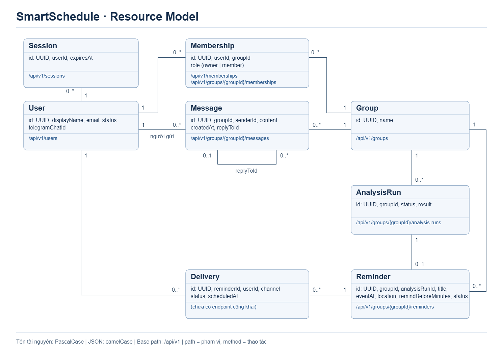
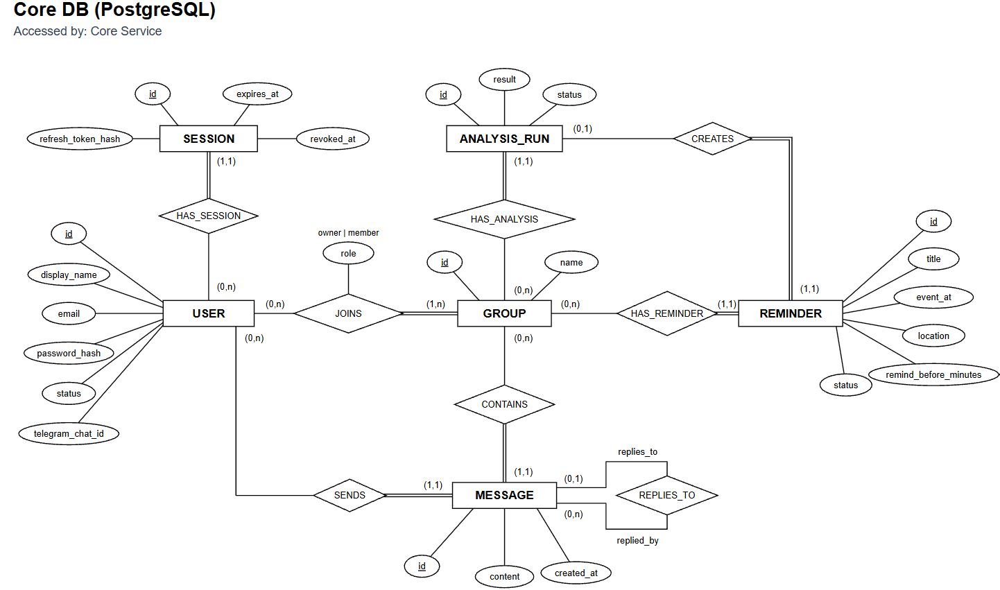
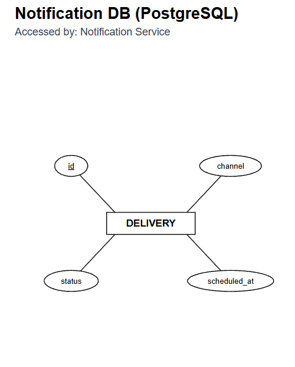
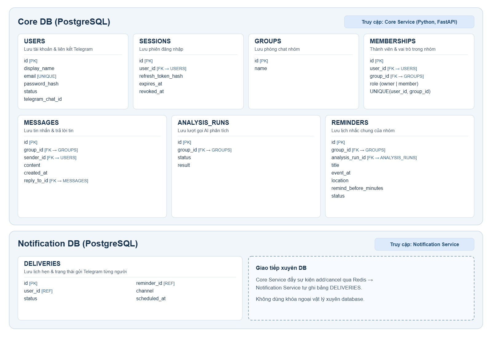
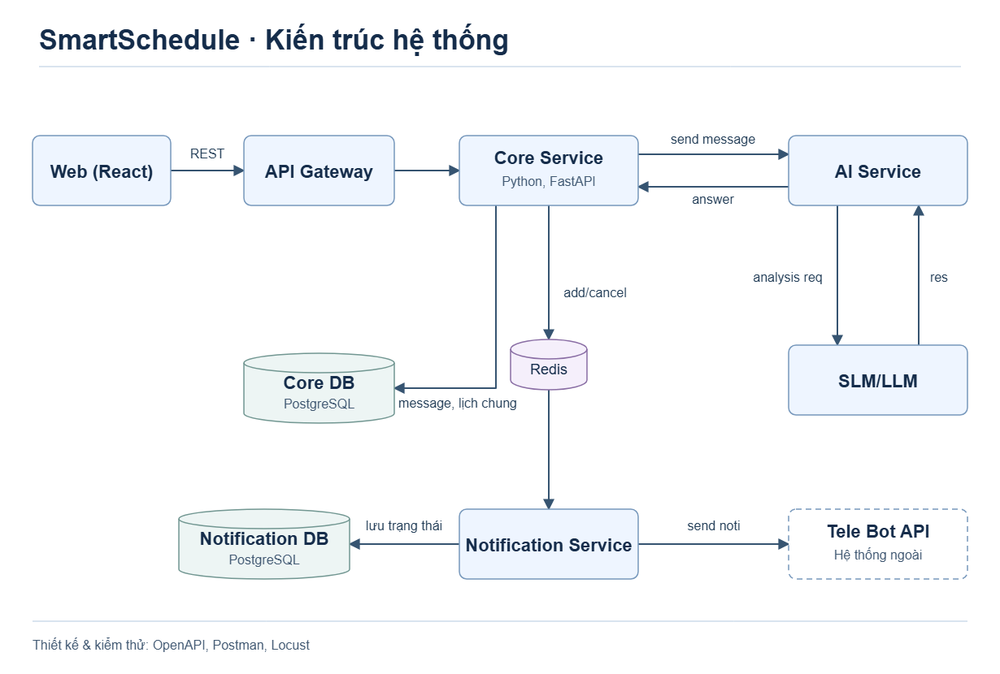

# 2. Resource model và kiến trúc · SmartSchedule

## 2.1. Resource model

Các tài nguyên trong bản thiết kế dùng UUID. Tên loại tài nguyên dùng PascalCase, trường JSON dùng camelCase. Đường dẫn API có tiền tố `/api/v1`. URL thể hiện phạm vi tài nguyên, HTTP method thể hiện thao tác.

| Tài nguyên | Vai trò và trường tiêu biểu trong bản thiết kế |
|---|---|
| `User` | Tài khoản người dùng. |
| `Session` | Phiên đăng nhập với `userId`, `expiresAt`. |
| `Group` | Phòng chat. |
| `Membership` | Liên kết người dùng với phòng và lưu vai trò `owner` hoặc `member`. |
| `Message` | Tin nhắn với `senderId`, `content`, `createdAt`, `replyToId`. |
| `AnalysisRun` | Một lần phân tích hội thoại, gồm `status` và `result`. |
| `Reminder` | Lịch nhắc chung với `title`, `eventAt`, `location`, `remindBeforeMinutes`. |
| `Delivery` | Lượt gửi nhắc cho một người nhận, gồm `userId`, `status`, `scheduledAt`. |

Một người dùng có thể có nhiều phiên và nhiều bản ghi thành viên. Một phòng chứa nhiều tin nhắn, lần phân tích và lịch nhắc. Mỗi tin nhắn có thể tham chiếu một tin được trả lời. Một lần phân tích có thể dẫn đến tối đa một lịch nhắc. Một lịch nhắc có thể phát sinh nhiều lượt gửi, mỗi lượt gắn với một người nhận.

## 2.2. Resource model, database schema và ERD

| Tiêu chí | Resource model | Database schema |
|---|---|---|
| Mục đích | Mô tả tài nguyên và dữ liệu trao đổi với client qua API. | Mô tả các bảng, cột và ràng buộc lưu trữ trong PostgreSQL. |
| Đặt tên | PascalCase cho tài nguyên như `AnalysisRun`, camelCase cho trường JSON. | snake_case cho bảng và cột như `analysis_runs` và `display_name`. |
| Dữ liệu nhạy cảm | Phản hồi chỉ chứa dữ liệu client được phép xem. | Lưu dữ liệu nội bộ cần thiết, ví dụ giá trị băm của mật khẩu và refresh token. |
| Quan hệ | Thể hiện qua ID liên kết hoặc URL có phạm vi, ví dụ `/groups/{groupId}/messages`. | Thể hiện qua khóa chính, khóa ngoại và ràng buộc duy nhất trong từng database. |

### Core DB

Core Service quản lý tài khoản, phiên, phòng, thành viên, tin nhắn, lần phân tích và lịch nhắc chung.

### Notification DB

Notification Service quản lý lượt gửi và trạng thái gửi. Các ID người nhận và lịch được truyền qua hàng đợi và dùng làm tham chiếu giữa các dịch vụ.

### Lược đồ bảng

## 2.3. Kiến trúc hệ thống và công nghệ

| Thành phần | Trách nhiệm |
|---|---|
| Web React và API Gateway | Web gọi REST API qua Gateway để truy cập Core Service. |
| Core Service · Python/FastAPI | Quản lý dữ liệu nghiệp vụ trên Core DB PostgreSQL. Gửi hội thoại sang AI Service, nhận kết quả và đưa yêu cầu đặt hoặc hủy nhắc vào Redis. |
| AI Service · SLM/LLM | Nhận yêu cầu phân tích, xử lý nội dung hội thoại và trả kết quả cho Core. |
| Notification Service · Redis, PostgreSQL, Telegram Bot API | Nhận yêu cầu nhắc từ Redis, gửi Telegram và lưu trạng thái vào Notification DB. |
| Công cụ | OpenAPI để mô tả hợp đồng, Postman để kiểm thử API và Locust để kiểm thử tải. |

Quy ước phản hồi lỗi gồm `code`, `message` và `requestId`. Xem [mục 3. API contract](03-api-contract.md) để tra mã trạng thái và schema chi tiết.
