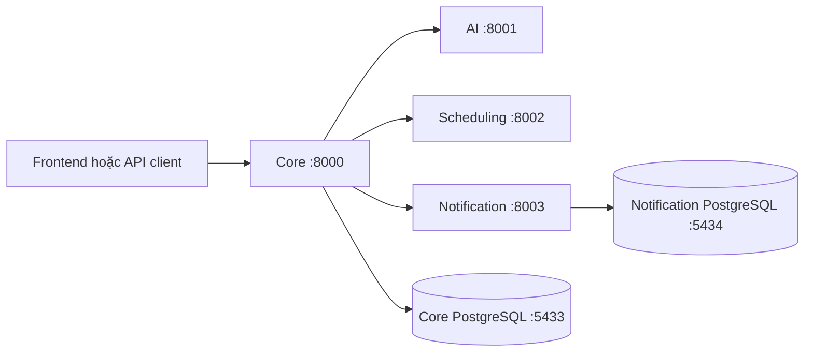

# SmartSchedule — Skeleton SOA

Skeleton cho nhóm 4 sinh viên: cấu hình, schema, SQLAlchemy models, endpoint fixture và test nền tảng.
**Chưa có nghiệp vụ thật.** Login chấp nhận credential đúng schema và cấp JWT cho user fixture;
register/task/draft không lưu dữ liệu. Không sử dụng bản skeleton như hệ thống đăng nhập thực tế.

## Kiến trúc



Frontend/Gateway chưa thuộc phạm vi skeleton được giao. Core clients đã có khung HTTP,
nhưng router hiện trả fixture, chưa gọi service khác. Compose chỉ chạy hai DB.

| Service | Owner | API | Swagger | DB |
|---|---|---|---|---|
| [Core](services/core/README.md) | A | http://127.0.0.1:8000 | http://127.0.0.1:8000/docs | PostgreSQL riêng, host 5433 |
| [AI](services/ai/README.md) | B | http://127.0.0.1:8001 | http://127.0.0.1:8001/docs | Không |
| [Scheduling](services/scheduling/README.md) | D | http://127.0.0.1:8002 | http://127.0.0.1:8002/docs | Không |
| [Notification](services/notification/README.md) | C | http://127.0.0.1:8003 | http://127.0.0.1:8003/docs | PostgreSQL riêng, host 5434 |

## 1. Chuẩn bị

Cài Python 3.11, Docker Desktop và Docker Compose v2. Chạy lệnh từ gốc repo.

```powershell
python --version
python -m venv .venv
.\.venv\Scripts\python.exe -m pip install -r requirements-dev.txt
.\.venv\Scripts\python.exe scripts/setup_local.py
docker compose up -d --wait
docker compose ps
```

Script setup tạo `.env` gốc và từng service nếu chưa tồn tại, dùng secret local ngẫu nhiên,
cùng internal key/JWT secret. File `.env` không commit. Không in secret trong log.
Nếu tự sửa DB user/password trong `.env`, cập nhật DATABASE_URL tương ứng ở service;
biến POSTGRES chỉ khởi tạo credential khi volume còn mới. Không xóa volume để sửa lỗi tùy tiện.

Phụ thuộc: FastAPI, Pydantic v2, pydantic-settings, SQLAlchemy 2.x, psycopg 3,
PyJWT, argon2-cffi, httpx, pytest, uvicorn. `tzdata` bổ sung IANA timezone trên Windows;
`psycopg[binary]` giúp chạy local mà không cần cài libpq riêng.

## 2. Chạy API ngoài container

Mở 4 terminal tại gốc repo, mỗi terminal chạy một lệnh:

```powershell
.\.venv\Scripts\python.exe -m uvicorn services.core.main:app --host 127.0.0.1 --port 8000
.\.venv\Scripts\python.exe -m uvicorn services.ai.main:app --host 127.0.0.1 --port 8001
.\.venv\Scripts\python.exe -m uvicorn services.scheduling.main:app --host 127.0.0.1 --port 8002
.\.venv\Scripts\python.exe -m uvicorn services.notification.main:app --host 127.0.0.1 --port 8003
```

Linux/macOS dùng `.venv/bin/python` thay `.venv\Scripts\python.exe`.
Truy cập `/health`, `/docs`, `/openapi.json` ở từng port.
Core/Notification tạo bảng dev qua `Base.metadata.create_all` khi startup; chưa có migration Alembic.
AI/Scheduling không khởi tạo DB. Dừng API bằng Ctrl+C. Dừng DB bằng `docker compose stop`.

## 3. Thử auth và stub

PowerShell tại gốc repo, sau khi Core chạy:

```powershell
$login = Invoke-RestMethod -Method Post -Uri 'http://127.0.0.1:8000/api/v1/auth/login' -ContentType 'application/json' -Body '{"email":"demo@example.com","password":"DemoPass123"}'
$headers = @{ Authorization = "Bearer $($login.data.accessToken)"; 'X-Request-Id' = 'demo-001' }
Invoke-RestMethod -Uri 'http://127.0.0.1:8000/api/v1/tasks' -Headers $headers
```

Với API nội bộ, đọc INTERNAL_API_KEY từ `.env` local và điền vào header `X-Internal-Api-Key`.
Không gửi internal key từ frontend. Confirm cần thêm `Idempotency-Key`; thiếu trả 400.
Response có `{requestId,data}` hoặc `{requestId,error}`; DELETE 204 không body là ngoại lệ đã duyệt.
Error.details là mảng `{field,reason}`. FastAPI validation được chuẩn hóa thành 400.

## 4. Kiểm thử không cần DB

```powershell
.\.venv\Scripts\python.exe -m pytest -q
.\.venv\Scripts\python.exe -m pytest services/core/tests -q
.\.venv\Scripts\python.exe -m pytest services/ai/tests -q
.\.venv\Scripts\python.exe -m pytest services/scheduling/tests -q
.\.venv\Scripts\python.exe -m pytest services/notification/tests -q
.\.venv\Scripts\python.exe -m scripts.check_contract
```

TestClient dùng app factory tắt DB initialization; fixture có secret test riêng.
Không cần SQLite, không gọi LLM/Telegram hoặc service khác.
Script check_contract đọc Excel, đối chiếu đủ 22 method/path/operationId trong OpenAPI.

### Kiểm tra khởi động thật

Sau khi hai DB healthy, chạy:

```powershell
.\.venv\Scripts\python.exe -m scripts.smoke_check
```

Script khởi động 4 Uvicorn local, kiểm tra health/Swagger/22 endpoint và schema hai DB, rồi tự dừng các API do script tạo. Kết quả lưu `.local/smoke-results.json`; không gọi LLM/Telegram, không chạy worker. Cần cài `requirements-dev.txt` vì script dùng lại dữ liệu request của test.

Nếu cổng 5433 hoặc 8000 đang do dự án khác sử dụng, không dừng dịch vụ đó tùy tiện. Dùng Compose override local cho Core DB và cổng API tạm khi kiểm tra. Cấu hình mặc định trong repo vẫn là DB 5433/5434, API 8000–8003.

```powershell
# Với file override local đã đặt Core DB tại 15433:
docker compose -f docker-compose.yml -f .local/verify-compose.yml up -d --wait
.\.venv\Scripts\python.exe -m scripts.smoke_check --core-port 18000 --core-db-port 15433
```

File `.local/verify-compose.yml` chỉ dùng local, không commit. Mẫu nội dung:

```yaml
services:
  core_db:
    ports: !override
      - "127.0.0.1:15433:5432"
```

## 5. Danh sách endpoint theo contract

| ID | Service | Method | Path |
|---|---|---|---|
| API-01 | Core | POST | `/api/v1/auth/register` |
| API-02 | Core | POST | `/api/v1/auth/login` |
| API-03 | Core | POST | `/api/v1/tasks` |
| API-04 | Core | GET | `/api/v1/tasks` |
| API-05 | Core | GET | `/api/v1/tasks/{id}` |
| API-06 | Core | PATCH | `/api/v1/tasks/{id}` |
| API-07 | Core | DELETE | `/api/v1/tasks/{id}` |
| API-08 | Core | POST | `/api/v1/tasks/{id}/complete` |
| API-09 | Core | POST | `/api/v1/schedule-drafts` |
| API-10 | Core | GET | `/api/v1/schedule-drafts/{id}` |
| API-11 | Core | PATCH | `/api/v1/schedule-drafts/{id}` |
| API-12 | Core | POST | `/api/v1/schedule-drafts/{id}/suggestions` |
| API-13 | Core | POST | `/api/v1/schedule-drafts/{id}/confirm` |
| API-14 | Core | GET | `/api/v1/calendar` |
| API-15 | Core | POST | `/api/v1/telegram/link-codes` |
| API-16 | Core | GET | `/api/v1/telegram/link` |
| INT-01 | AI | POST | `/internal/v1/extractions` |
| INT-02 | Scheduling | POST | `/internal/v1/conflicts` |
| INT-03 | Scheduling | POST | `/internal/v1/suggestions` |
| INT-04 | Notification | POST | `/internal/v1/telegram/link-codes` |
| INT-05 | Notification | GET | `/internal/v1/telegram/links/{userId}` |
| INT-06 | Notification | POST | `/internal/v1/reminder-events` |

## 6. Cấu trúc

```text
.env.example
.gitignore
docker-compose.yml
requirements-dev.txt
pytest.ini
README.md
docs/                          # Giữ nguyên toàn bộ
scripts/
  setup_local.py               # Tạo cấu hình local, không ghi đè
  check_contract.py            # Đối chiếu 22 endpoint từ Excel
services/
  core/
    main.py, config.py, database.py, models.py
    requirements.txt, .env.example, README.md
    routers/                   # auth,tasks,drafts,calendar,telegram
    schemas/, services/, utils/, tests/
    clients/                   # Khung httpx có timeout/requestId/auth
    workers/outbox_dispatcher.py
  ai/
    main.py, config.py, requirements.txt, .env.example, README.md
    routers/extractions.py
    schemas/, services/, utils/, tests/
    clients/llm_client.py
  scheduling/
    main.py, config.py, requirements.txt, .env.example, README.md
    routers/conflicts.py, routers/suggestions.py
    schemas/, services/, utils/, tests/
  notification/
    main.py, config.py, database.py, models.py
    requirements.txt, .env.example, README.md
    routers/telegram.py, routers/reminder_events.py
    schemas/, services/, utils/, tests/
    workers/reminder_sender.py
```

## 7. Điểm đã xử lý và giả định

- Dùng đúng file thực tế: `docs/02.Usecase.md`, `docs/03.database.md`, `docs/api-contract.xlsx`.
  Đã được người dùng xác nhận; không tạo/đổi tên/sửa file docs.
- DELETE 204 không body là ngoại lệ envelope được người dùng xác nhận. Vẫn có X-Request-Id header.
- Excel là bản nháp v2, có calendar riêng, cursor và `/schedule-drafts`; không dùng contract cũ trong chat.
- Nội bộ dùng `X-Internal-Api-Key` theo yêu cầu mới; sheet Conventions chưa quy định cơ chế cụ thể.
- DELETE expectedVersion chọn query theo đề xuất ở sheet Open issues.
- INT-04 cho phép 200/201: chọn 201. INT-06 dùng 200 và `{result:"accepted"}` theo Excel.
- Chọn JWT 60 phút, mật khẩu 8–128 ký tự, AI timeout 30s và Scheduling/Notification 5s.
- maxResults mặc định 3 cho public suggestions; giới hạn1–3. Không thực thi thuật toán tìm giờ.
- Sheet Errors mô tả conflict bằng details.conflicts nhưng Conventions yêu cầu details là mảng.
  Skeleton dùng mảng chuẩn; chưa triển khai lỗi conflict thực tế, cần chốt biểu diễn danh sách conflict trước nghiệp vụ.
- UC-15/16 không có trong danh sách P0: không thêm route unlink/relink.
- Lỗi định tuyến framework404/405 được bọc envelope, dùng VALIDATION_ERROR và giữ HTTP status;
  chưa có mã routing riêng trong Errors. Lỗi tài nguyên nghiệp vụ sau này dùng *_NOT_FOUND theo contract.

## 8. TODO cho bước tiếp theo

- Auth thật: lưu user, hash/verify, quyền tài nguyên; không dùng fixture login nữa.
- CRUD/draft/state/TTL/version/cursor và calendar thật.
- Chốt khóa/ràng buộc chống overlap; không coi version hoặc gọi Scheduling là đủ.
- Confirm atomic + idempotency, xử lý replay trước draft hết hạn/đã dùng.
- HTTP orchestration thật; schema output service và mapping lỗi phụ thuộc.
- LLM adapter; Telegram adapter, mã dùng1 lần và mapping thật.
- Outbox dispatcher, reminder worker, lease/retry/dedup/stale/cancel; accepted chỉ sau persist.
- Alembic và chính sách dọn dữ liệu; không dọn tombstone/dedup sớm hơn khả năng event replay.
- Kiểm thử nghiệp vụ, concurrency và lỗi phân tán sau khi triển khai thật.

## Tài liệu nguồn

- [Tổng quan](docs/01.tongquan.md)
- [Use Case P0](docs/02.Usecase.md)
- [Thiết kế database](docs/03.database.md)
- [API contract](docs/api-contract.xlsx)
