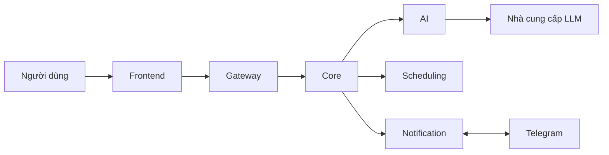

# SmartSchedule — Tổng quan hệ thống

**Phạm vi:** MVP F01–F10.  
**Thiết kế:** Bốn service nghiệp vụ; contract API và DB đang ở bản nháp để review.

**Tài liệu liên quan:** [Use Case P0](02.Usecase.md) · [Thiết kế database](03.database.md) · [API contract](api-contract.xlsx)

## 1. Mục tiêu

SmartSchedule là trợ lý lập lịch cá nhân bằng tiếng Việt. Người dùng
có thể tạo công việc thủ công hoặc nhập yêu cầu tự nhiên, xem thời gian
được đề xuất, xác nhận lưu và nhận nhắc việc qua Telegram.

> Ví dụ: “Ngày mai làm bài SOA trong 90 phút, xong trước 17 giờ.”

Dự án áp dụng kiến trúc hướng dịch vụ (SOA), giúp bốn thành viên thực
hành xây dựng service độc lập và tích hợp qua API có contract thống nhất.

## 2. Phạm vi MVP

### Thực hiện

- Đăng ký, đăng nhập bằng JWT; quản lý dữ liệu riêng theo tài khoản.
- Tạo, xem, sửa, xóa và đánh dấu hoàn thành công việc.
- Nhập yêu cầu tiếng Việt; AI trích xuất thông tin và xác định trường thiếu.
- Kiểm tra xung đột lịch, tìm khoảng trống và đề xuất thời gian.
- Cho người dùng xem, chỉnh sửa và xác nhận trước khi lưu.
- Xem lịch cá nhân theo ngày và danh sách.
- Liên kết Telegram, nhận nhắc trước 5, 10, 15 hoặc 30 phút.

### Chưa thực hiện trong MVP

- Công việc lặp và thống kê hoàn thành.
- API Developer/webhook tích hợp ứng dụng ngoài.
- Đồng bộ Google Calendar hai chiều.
- Ứng dụng Android/iOS native.
- Hội thoại AI nhiều lượt có ngữ cảnh phức tạp.

## 3. Các service và trách nhiệm

| Service | Phụ trách | Vai trò |
|---|---|---|
| Core | A | Xác thực, CRUD công việc, quản lý bản nháp, điều phối, xác nhận và lưu lịch, ghi outbox. |
| AI | B | Trích xuất thông tin tiếng Việt, xác định trường thiếu/cảnh báo, kết nối LLM. |
| Notification | C | Liên kết Telegram, quản lý job nhắc, gửi thông báo, retry và chống xử lý event trùng/cũ. |
| Scheduling | D | Kiểm tra xung đột, tìm khoảng trống và đề xuất thời gian từ dữ liệu Core cung cấp. |

Hệ thống có một frontend và Gateway dùng chung. Core sở hữu dữ liệu
tài khoản, công việc, bản nháp và outbox. Notification sở hữu dữ liệu
liên kết Telegram và nhắc việc. AI và Scheduling không bắt buộc có DB.

## 4. Kiến trúc giao tiếp

Frontend gọi public API qua Gateway. Core gọi AI để trích xuất,
Scheduling để kiểm tra/tìm giờ và chuyển event nhắc sang Notification
qua bộ phát outbox. Notification tương tác với Telegram.

### API giữa các service — bản nháp

| Service gọi | Service được gọi | Endpoint | Mục đích |
|---|---|---|---|
| Core | AI | `POST /internal/v1/extractions` | Trích xuất thông tin tiếng Việt, trường thiếu và cảnh báo. |
| Core | Scheduling | `POST /internal/v1/conflicts` | Kiểm tra xung đột khi tạo, sửa hoặc xác nhận công việc. |
| Core | Scheduling | `POST /internal/v1/suggestions` | Tìm khoảng trống và đề xuất thời gian. |
| Core | Notification | `POST /internal/v1/telegram/link-codes` | Tạo mã liên kết Telegram một lần. |
| Core | Notification | `GET /internal/v1/telegram/links/{userId}` | Đọc trạng thái liên kết Telegram. |
| Core — bộ phát outbox | Notification | `POST /internal/v1/reminder-events` | Chuyển event tạo, cập nhật hoặc hủy nhắc sau khi lưu công việc. |

Đây là API nội bộ, không được frontend gọi trực tiếp. AI → LLM và Notification ↔ Telegram là tích hợp bên ngoài; tiếp nhận event nhắc chưa có nghĩa Telegram đã gửi.

## 5. Nguyên tắc thiết kế

- AI chỉ tạo thông tin cho bản nháp; thiếu dữ liệu phải yêu cầu bổ sung.
- Gợi ý giờ không giữ chỗ; chỉ tạo công việc sau khi người dùng xác nhận.
- Core kiểm tra lại lịch mới nhất và bảo vệ thao tác lưu khi có yêu cầu đồng thời.
- Chỉ tạo nhắc cho công việc đã lưu và đủ điều kiện nhắc.
- Mỗi service chỉ truy cập DB của mình, trao đổi với service khác qua API.
- Mỗi thành viên chịu trách nhiệm API, test và README của service mình.
