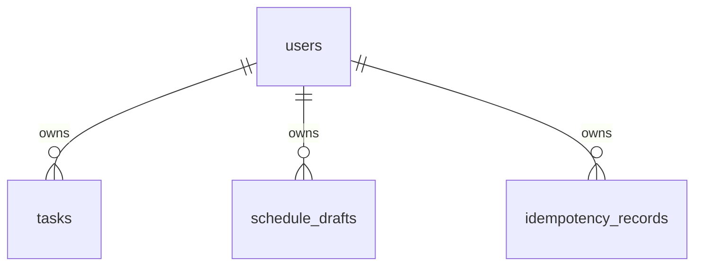
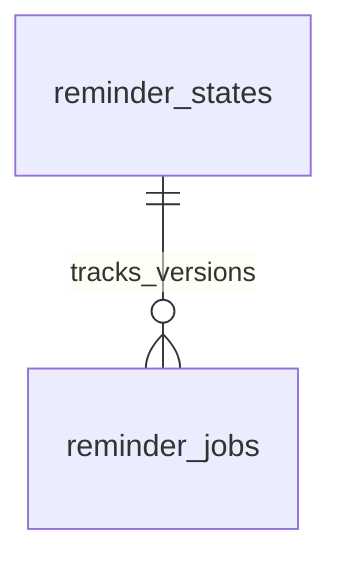

# SmartSchedule — Thiết kế cơ sở dữ liệu

**Phạm vi:** MVP F01–F10.  
**Trạng thái:** Thiết kế logic đề xuất; chưa khóa DB engine, SQL hoặc migration.

**Tài liệu liên quan:** [Tổng quan hệ thống](01.tongquan.md) · [Use Case P0](02.Usecase.md) · [API contract](api-contract.xlsx)

## 1. Nguyên tắc và quyền sở hữu

- Core và Notification sở hữu DB riêng; service không truy vấn hoặc tạo foreign key xuyên DB.
- AI và Scheduling không bắt buộc có DB trong MVP.
- ID trao đổi dưới dạng chuỗi. Tên trường DB dùng `snake_case`; API dùng `camelCase`.
- Lưu thời điểm nhất quán theo UTC; API dùng RFC3339 có offset/Z. Lưu timezone IANA riêng để hiển thị và diễn giải ngày.
- Kiểu JSON, enum và timestamp bên dưới là kiểu logic; cách lưu vật lý phụ thuộc DB engine.

| Service | Owner | Dữ liệu sở hữu |
|---|---|---|
| Core | A | Tài khoản, công việc, bản nháp, idempotency, outbox |
| Notification | C | Liên kết Telegram, mã liên kết, event, phiên bản nhắc, job |
| AI | B | Không lưu dữ liệu nghiệp vụ trong MVP |
| Scheduling | D | Không lưu dữ liệu nghiệp vụ trong MVP |

Core là nguồn dữ liệu chuẩn của task. Notification lưu bản thông tin cần thiết để nhắc; không sở hữu task.

## 2. Sơ đồ quan hệ

### Core DB

Liên kết logic không bắt buộc foreign key:

- `schedule_drafts.confirmed_task_id` giữ ID task đã tạo.
- `outbox_events.task_id` xác định task phát sinh event.
- Hai dữ liệu này vẫn được giữ khi task bị xóa.

### Notification DB

Các bảng liên kết logic qua `user_id`, `task_id`, `event_id`; không có foreign key sang Core. Job có thể chờ liên kết nên không bắt buộc có hàng `telegram_links` tương ứng ngay lúc tạo.

## 3. Core DB

### 3.1. `users` — Tài khoản

| Trường | Kiểu logic | Nullable | Ràng buộc / ý nghĩa |
|---|---|---|---|
| `id` | ID | Không | Primary key |
| `email` | String | Không | Unique sau trim và chuẩn hóa chữ thường |
| `password_hash` | String | Không | Giá trị băm, không lưu mật khẩu gốc |
| `created_at` | Timestamp | Không | Thời điểm tạo |
| `updated_at` | Timestamp | Không | Thời điểm cập nhật |

**Quy tắc:** Unique email được bảo vệ tại DB. API không trả `password_hash`.

### 3.2. `tasks` — Công việc chính thức

| Trường | Kiểu logic | Nullable | Ràng buộc / ý nghĩa |
|---|---|---|---|
| `id` | ID | Không | Primary key |
| `user_id` | ID | Không | FK → `users.id` |
| `title` | String | Không | Trim, 1–200 ký tự |
| `status` | Enum | Không | `pending` / `completed` |
| `start_at` | Timestamp | Có | Giờ bắt đầu |
| `end_at` | Timestamp | Có | Giờ kết thúc do Core tính |
| `duration_minutes` | Integer | Không | 1–1440 phút |
| `deadline_at` | Timestamp | Có | Hạn hoàn thành |
| `timezone` | String | Không | Timezone IANA |
| `reminder_minutes` | Integer | Có | null / 5 / 10 / 15 / 30 |
| `version` | Integer | Không | Bắt đầu từ 1 |
| `created_at` | Timestamp | Không | Thời điểm tạo |
| `updated_at` | Timestamp | Không | Thời điểm cập nhật |

**Ràng buộc:**

- `start_at` và `end_at` cùng null hoặc cùng có giá trị.
- Có lịch thì `end_at > start_at` và `end_at = start_at + duration_minutes`.
- Có lịch và deadline thì `end_at <= deadline_at`.
- Task chưa lên lịch không chiếm lịch và không tạo job.
- Task completed vẫn giữ khoảng lịch; xóa task giải phóng khoảng đó.
- Khoảng thời gian dùng `[start_at, end_at)`.

**Index đề xuất:** `(user_id, start_at)`; `(user_id, created_at, id)`.

> Index thường không tự ngăn overlap. Cơ chế khóa, transaction hoặc ràng buộc chống chồng lịch phải chọn theo DB engine trước implementation.

### 3.3. `schedule_drafts` — Bản nháp

| Trường | Kiểu logic | Nullable | Ràng buộc / ý nghĩa |
|---|---|---|---|
| `id` | ID | Không | Primary key |
| `user_id` | ID | Không | FK → `users.id` |
| `source_text` | Text | Không | Yêu cầu tiếng Việt ban đầu |
| `fields` | JSON | Không | Thông tin đang chỉnh sửa |
| `missing_fields` | JSON array | Không | Trường chưa có |
| `required_input_fields` | JSON array | Không | Trường người dùng cần bổ sung |
| `warnings` | JSON array | Không | Cảnh báo trích xuất |
| `suggestions` | JSON array | Không | Gợi ý hiện tại |
| `state` | Enum | Không | Trạng thái draft |
| `version` | Integer | Không | Bắt đầu từ 1 |
| `confirmed_task_id` | ID | Có | ID lịch sử, không bắt buộc FK |
| `expires_at` | Timestamp | Không | Thời điểm hết hạn |
| `created_at` | Timestamp | Không | Thời điểm tạo |
| `updated_at` | Timestamp | Không | Thời điểm cập nhật |

| State | Ý nghĩa |
|---|---|
| `needs_input` | Cần bổ sung dữ liệu |
| `ready_to_schedule` | Đủ đầu vào tìm giờ |
| `ready_to_confirm` | Đủ dữ liệu tạo task |
| `confirmed` | Đã tạo task chính thức |

`fields` chứa `title`, `date`, `startAt`, `durationMinutes`, `deadlineAt`, `timezone`, `reminderMinutes` theo DTO public.

**Quy tắc:** TTL 30 phút, không kéo dài khi sửa. Thay điều kiện lập lịch làm mất hiệu lực gợi ý cũ. Một draft chỉ tạo tối đa một task. Draft confirmed không sửa được; xóa task không làm draft trở lại trạng thái có thể confirm. Draft chưa confirm không tạo nhắc.

### 3.4. `idempotency_records` — Kết quả chống tạo trùng

| Trường | Kiểu logic | Nullable | Ràng buộc / ý nghĩa |
|---|---|---|---|
| `id` | ID | Không | Primary key |
| `user_id` | ID | Không | FK → `users.id` |
| `operation` | String | Không | Ví dụ `confirm_draft` |
| `idempotency_key` | String | Không | Khóa client cung cấp |
| `request_hash` | String | Không | Băm operation + draftId + body chuẩn hóa |
| `response_status` | Integer | Không | HTTP status đã lưu |
| `response_data` | JSON | Không | Phần data kết quả |
| `created_at` | Timestamp | Không | Thời điểm tạo |
| `expires_at` | Timestamp | Không | Hết hạn lưu kết quả |

**Unique:** `(user_id, operation, idempotency_key)`.

**Quy tắc:** Cùng key/cùng request trả kết quả cũ; cùng key/khác request bị từ chối. Lưu kết quả thành công cùng transaction confirm. Thời hạn lưu đề xuất 24 giờ. Không lưu requestId cũ; replay được xét trước khi từ chối draft đã dùng/hết hạn.

### 3.5. `outbox_events` — Event chờ chuyển

| Trường | Kiểu logic | Nullable | Ràng buộc / ý nghĩa |
|---|---|---|---|
| `event_id` | ID | Không | Primary key |
| `event_type` | String | Không | Ví dụ `reminder_changed` |
| `task_id` | ID | Không | Không bắt buộc FK |
| `task_version` | Integer | Không | Phiên bản thay đổi |
| `payload` | JSON | Không | Nội dung gửi Notification |
| `status` | Enum | Không | `pending` / `processing` / `delivered` |
| `attempt_count` | Integer | Không | Mặc định 0 |
| `next_attempt_at` | Timestamp | Không | Thời điểm thử tiếp |
| `locked_until` | Timestamp | Có | Hạn quyền xử lý của worker |
| `last_error` | Text | Có | Lỗi gần nhất |
| `created_at` | Timestamp | Không | Thời điểm tạo |
| `delivered_at` | Timestamp | Có | Thời điểm bên nhận xác nhận |

**Quy tắc:** Lưu cùng transaction task; retry giữ event_id. Khi worker chết, event được nhận lại sau khi quyền xử lý hết hạn. `delivered` chỉ có nghĩa Notification tiếp nhận, chưa phải Telegram gửi. Event cancel vẫn tồn tại sau khi task bị xóa.

## 4. Notification DB

### 4.1. `telegram_links` — Liên kết đã xác minh

| Trường | Kiểu logic | Nullable | Ràng buộc / ý nghĩa |
|---|---|---|---|
| `user_id` | ID | Không | Primary key; ID từ Core |
| `chat_id` | String | Không | Unique |
| `linked_at` | Timestamp | Không | Thời điểm xác minh |

**Quy tắc:** Một user một chat riêng; một chat một user. chat_id lấy từ tương tác Telegram đã xác minh, lưu dạng chuỗi để tránh mất chính xác. Không FK sang Core.

### 4.2. `telegram_link_codes` — Mã liên kết

| Trường | Kiểu logic | Nullable | Ràng buộc / ý nghĩa |
|---|---|---|---|
| `id` | ID | Không | Primary key |
| `user_id` | ID | Không | Người xin mã |
| `code_hash` | String | Không | Unique; không lưu mã gốc |
| `expires_at` | Timestamp | Không | TTL đề xuất 10 phút |
| `used_at` | Timestamp | Có | Thời điểm đã dùng |
| `invalidated_at` | Timestamp | Có | Thời điểm vô hiệu |
| `created_at` | Timestamp | Không | Thời điểm tạo |

**Quy tắc:** Mã dùng một lần; mã mới vô hiệu mã chờ cũ. Chỉ nhận mã chưa dùng/chưa vô hiệu/chưa hết hạn. Tiêu thụ mã và tạo mapping phải atomic.

### 4.3. `reminder_events` — Event đã tiếp nhận

| Trường | Kiểu logic | Nullable | Ràng buộc / ý nghĩa |
|---|---|---|---|
| `event_id` | ID | Không | Primary key |
| `task_id` | ID | Không | Task liên quan |
| `task_version` | Integer | Không | Phiên bản event |
| `payload_hash` | String | Không | Băm payload chuẩn hóa |
| `result` | Enum | Không | `accepted` / `ignored_stale` |
| `received_at` | Timestamp | Không | Thời điểm nhận |

**Quy tắc:** Cùng ID/hash trả duplicate, không thêm hàng. Cùng ID/khác hash báo lỗi. Kiểm duplicate trước stale; ghi event, state và job atomic. Chỉ trả accepted sau persist.

### 4.4. `reminder_states` — Phiên bản nhắc mới nhất

| Trường | Kiểu logic | Nullable | Ràng buộc / ý nghĩa |
|---|---|---|---|
| `task_id` | ID | Không | Primary key |
| `user_id` | ID | Không | Chủ sở hữu |
| `latest_version` | Integer | Không | Phiên bản mới nhất đã xử lý |
| `latest_action` | Enum | Không | `upsert` / `cancel` |
| `updated_at` | Timestamp | Không | Thời điểm cập nhật |

**Quy tắc:** Event khác ID có version không lớn hơn latest_version bị coi là cũ. Cancel vẫn giữ dấu phiên bản để upsert cũ không khôi phục nhắc.

### 4.5. `reminder_jobs` — Job nhắc

| Trường | Kiểu logic | Nullable | Ràng buộc / ý nghĩa |
|---|---|---|---|
| `id` | ID | Không | Primary key |
| `task_id` | ID | Không | Task liên quan |
| `task_version` | Integer | Không | Phiên bản tạo job |
| `user_id` | ID | Không | Người nhận |
| `title` | String | Không | Tiêu đề để gửi |
| `start_at` | Timestamp | Không | Giờ bắt đầu task |
| `timezone` | String | Không | Timezone hiển thị |
| `reminder_minutes` | Integer | Không | 5 / 10 / 15 / 30 |
| `due_at` | Timestamp | Không | start_at trừ số phút nhắc |
| `status` | Enum | Không | Theo bảng trạng thái bên dưới |
| `attempt_count` | Integer | Không | Mặc định 0 |
| `next_attempt_at` | Timestamp | Có | Thời điểm thử tiếp |
| `locked_until` | Timestamp | Có | Hạn quyền xử lý |
| `last_error` | Text | Có | Lỗi gần nhất |
| `sent_at` | Timestamp | Có | Ghi nhận gửi thành công |
| `created_at` | Timestamp | Không | Thời điểm tạo |
| `updated_at` | Timestamp | Không | Thời điểm cập nhật |

**Unique:** `(task_id, task_version)`.  
**Index đề xuất:** `(status, next_attempt_at)`; `(user_id, status)`.

| Status | Ý nghĩa |
|---|---|
| `waiting_link` | Chưa có liên kết Telegram |
| `pending` | Chờ đến hạn hoặc retry |
| `sending` | Worker đang xử lý |
| `sent` | Telegram đã xác nhận chấp nhận |
| `cancelled` | Bị hủy hoặc thay thế |
| `skipped` | Không còn đủ điều kiện thời gian để gửi |
| `failed` | Thất bại và dừng thử |

**Quy tắc:** Version mới hủy/thay thế job cũ chưa gửi. Worker kiểm job hiện hành và mapping trước gửi, nhận quyền xử lý atomic và phục hồi theo locked_until. `sent` không có nghĩa user đã đọc. Timeout có thể gây tin trùng khi retry, không cam kết gửi đúng một lần tuyệt đối.

## 5. Transaction và kiểm soát đồng thời

### Các thao tác cần nhất quán

| Thao tác | Dữ liệu trong cùng transaction |
|---|---|
| Tạo/sửa task | Task và outbox tương ứng |
| Xóa task | Xóa task và tạo cancel |
| Hoàn thành | Đổi trạng thái, tăng version, tạo cancel |
| Confirm | Task, draft confirmed, idempotency, outbox |
| Xác minh Telegram | Kiểm tra/tiêu thụ mã và lưu mapping |
| Nhận event | Dedup event, reminder_states và job |

Hai DB không dùng chung transaction. Outbox, retry và dedup giúp chuyển thay đổi giữa hai service.

### Các trường hợp đồng thời

- **Sửa cùng task:** cập nhật theo id, user_id và expectedVersion; không khớp version thì từ chối.
- **Hai task khác nhau chồng lịch:** version từng task không đủ; cần khóa theo user/lịch hoặc ràng buộc DB phù hợp. Kết quả Scheduling không thay thế việc bảo vệ trước commit.
- **Confirm cùng draft:** unique key chống retry trùng; trạng thái draft ngăn tạo task bằng key khác; các thay đổi cùng transaction.
- **Gửi/hủy nhắc:** kiểm phiên bản trước gửi; cancel đến sau khi Telegram đã nhận không bảo đảm thu hồi tin.

## 6. Các điểm cần chốt trước migration

- DB engine và kiểu vật lý cho ID, timestamp, JSON, enum.
- Cơ chế chống overlap khi lưu đồng thời.
- Thời gian giữ/dọn draft, idempotency, outbox và event.
- Cách phục hồi job sending sau khi worker chết.
- Thời hạn lưu lỗi và dữ liệu lịch sử.

> Không dọn dấu phiên bản cancel hoặc dữ liệu dedup khi vẫn có khả năng event cũ được gửi lại. Chính sách dọn dữ liệu phải xét thời hạn retry của cả Core và Notification. Các giới hạn, TTL và policy chi tiết vẫn cần review cùng contract.
